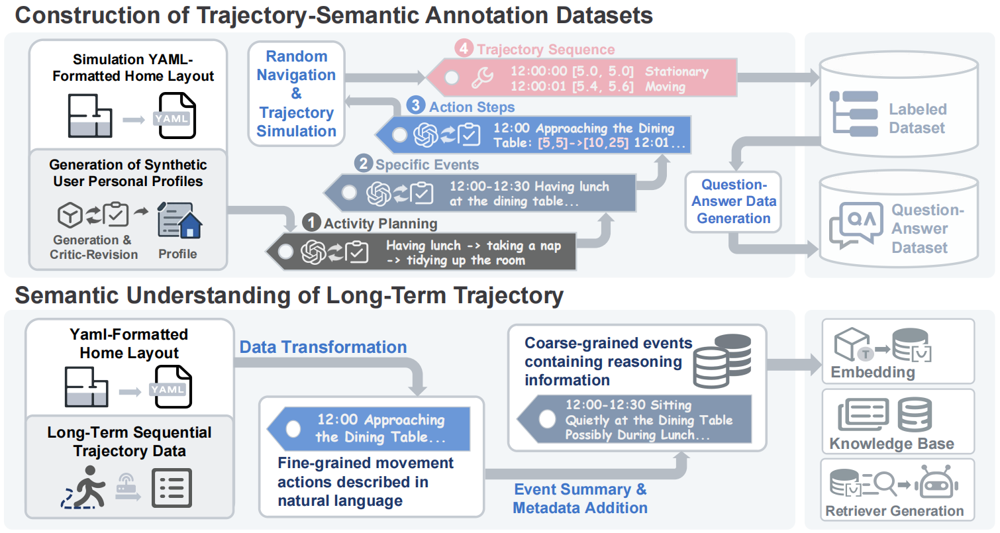
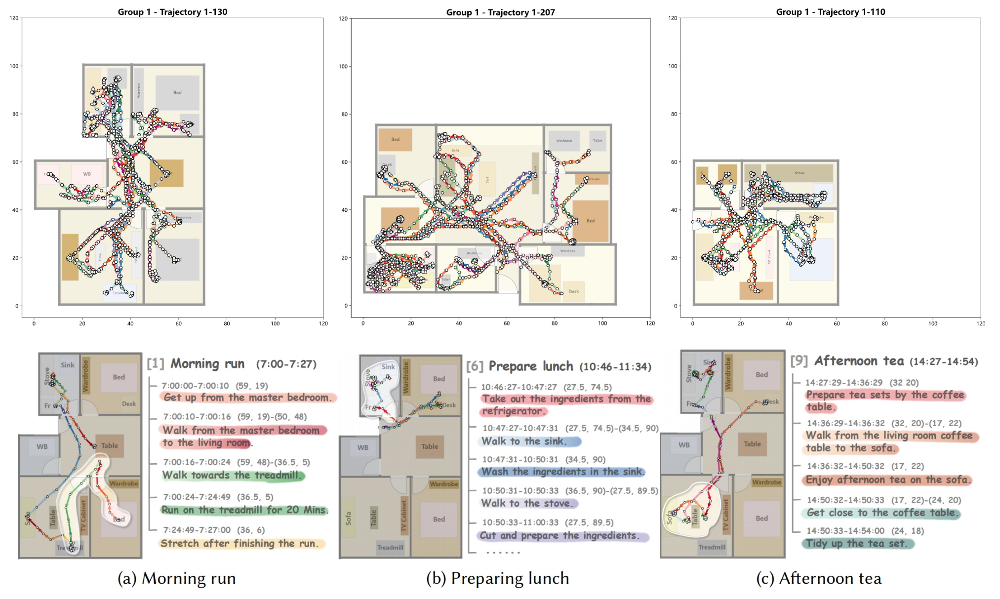
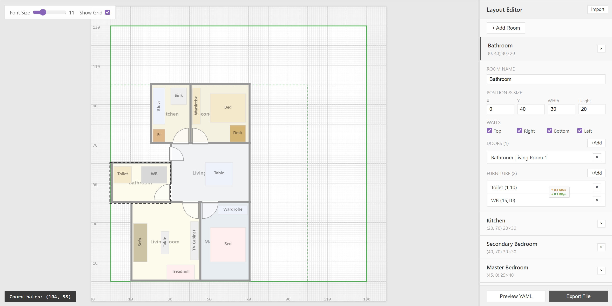

# TSGen: A Framework for Indoor Trajectory-Semantic Data Synthesis



> **TSGen** addresses the critical bottleneck in smart home research: the lack of large-scale annotated datasets for trajectory-semantic understanding. By combining LLM-driven behavior simulation with physics-constrained trajectory synthesis, and a self-refining prompt architecture that evolves from runtime errors, TSGen generates realistic indoor trajectories aligned with rich semantic annotations. We also provide a hierarchical semantic understanding baseline for long-term trajectory analysis.

[](https://dl.acm.org/journal/imwut)
[](https://osf.io/q3ej2/overview?view_only=38b70ce360af4ca09e8df321ebbff01c)
[](https://tsgen-yaml.netlify.app)
[](LICENSE)

---

## Key Features

- **Hierarchical Behavior Simulation**: 4-layer decomposition from daily plans to fine-grained trajectories
- **Physics-Constrained Paths**: A* navigation with stochastic potential fields for human-like movement
- **Self-Refining Prompts**: Dynamic constraint layer that automatically evolves from runtime errors
- **Semantic Understanding Baseline**: RAG-based framework for long-term trajectory semantic analysis
- **Open Resources**: trajectory-semantic pairs in the T-S Dataset

---


## Installation

- Python 3.10+
- OpenAI API key (GPT-4o recommended)

```bash
# Clone the repository
git clone
cd TSGen

# Install dependencies
pip install -r requirements.txt

# Configure API key
echo "OPENAI_API_KEY=your-api-key" > .env
```

---

## Quick Start

### 1. Generate Resident Profiles

Create diverse character profiles based on occupations:

```bash
python profile_generator/batch_run.py
```

### 2. Single Simulation

Generate a 24-hour trajectory for one resident:

```bash
python single_run.py \
  --profile path/to/profile.txt \
  --layout path/to/layout.yaml \
  --output ./output
```

**Options:**
- `--prompt-version`: `full` (with constraints) or `core` (minimal) - default: `full`
- `--log-level`: Logging verbosity

### 3. Batch Simulation

Generate trajectories for multiple resident-layout combinations:

```bash
python batch_run.py \
  -p ./profiles \
  -l ./layouts \
  -o ./output \
  --max-concurrent 50 \
  --max-retries 3
```

**File naming convention:**
- Profile: `{layout_id}-{Occupation}.txt` (e.g., `1-Teacher.txt`)
- Layout: `{layout_id}.yaml` (e.g., `1.yaml`)

---

## Project Structure

```
TSGen/
|-- agents/                      # Core agent modules
|   |-- planning_agent.py       # Generates daily activity plans
|   |-- event_agent.py          # Decomposes activities into events
|   |-- action_step_agent.py    # Refines events into action steps
|   |-- trajectory_agent.py     # Synthesizes physical trajectories
|   |-- data_models.py          # Pydantic data models
|   +-- prompts/
|       |-- prompts_full.py     # Full prompts with constraints
|       +-- prompts_core.py     # Core prompts (minimal)
|
|-- utils/
|   |-- navigation.py           # A* pathfinding + potential fields
|   |-- logger.py               # Thread-safe logging
|   |-- stats.py                # Token usage statistics
|   +-- tools.py                # JSON conversion utilities
|
|-- yaml_layout/
|   |-- draw.py                 # Layout visualization
|   +-- readme.md               # YAML format specification
|
|-- profile_generator/          # Resident profile generation
|   |-- profile_generator.py
|   +-- batch_run.py
|
|-- evaluation/                  # Evaluation tools
|   |-- navigation/             # Navigation path testing
|   |-- visualization/          # Trajectory visualization
|   |-- diversity/              # Diversity metrics (JSD, Edit Distance)
|   +-- ablation/               # LLM call statistics analysis
|
|-- workflow.py                 # LangGraph workflow orchestration
|-- single_run.py               # Single simulation entry point
+-- batch_run.py                # Batch simulation entry point
```

---

## Data Formats

### Output: Trajectory-Semantic JSON

Each simulation produces a JSON file containing hierarchical behavioral data:

```json
{
  "info": { "counts": {...}, "usage": {...} },
  "simulation_id": "unique-id",
  "activity_plans": [...],
  "events": [...],
  "action_steps": [...],
  "trajectories": [...],
  "created_at": "2025-01-01T00:00:00"
}
```

**Action Types:**

| Type | Description | Key Fields |
|------|-------------|------------|
| `movement` | Spatial displacement | `start_position`, `end_position` |
| `stationary` | Staying in place | `center_position`, `fluctuation_radius` |
| `absent` | Outside the house | `reason`, `location_description` |

> **Full specification:** [docs/data-format.md](docs/data-format.md)

### Input: House Layout (YAML)

Describe home environments with rooms, walls, doors, and furniture:

```yaml
house:
  size: { x: 100, y: 100 }  # Unit: decimeters
  rooms:
    - name: "Living Room"
      position: { x: 0, y: 0, width: 50, height: 40 }
      walls: { top: true, right: true, bottom: true, left: true }
      doors:
        - name: "Entrance"
          points: [[50, 10], [50, 20], [40, 10]]
      furniture:
        - name: "Sofa"
          id: sofa_001
          position: { x: 10, y: 15, width: 20, height: 10 }
```

> **Full specification:** [yaml_layout/readme.md](yaml_layout/readme.md)

---

## Evaluation Tools

### Navigation Testing

Visualize A* pathfinding with potential field and human-like trajectory:

```bash
python evaluation/navigation/test_navigation.py \
  -y yaml_layout/data/1.yaml \
  -p 10,10,80,60 \
  -o ./figures
```

### Trajectory Visualization

Generate trajectory visualization with semantic annotations (showing first 20 trajectories):

```bash
python evaluation/visualization/trajectory_visualizer.py \
  -j output/1-Teacher.json \
  -o ./figures
```

### Diversity Metrics

Compare trajectory diversity between two files:

```bash
python -m evaluation.diversity.single_run \
  file1.json file2.json \
  -y layout.yaml \
  -g 3.0
```

Batch evaluation across multiple layouts:

```bash
python -m evaluation.diversity.batch_run \
  -i ./output \
  -y ./yaml_layout/data \
  -g 3.0
```

**Metrics:**
- **Spatial JSD**: Jensen-Shannon divergence of spatial occupancy distributions
- **N-gram JSD**: Divergence of furniture interaction sequences (2/3/4-gram)
- **Edit Distance**: Levenshtein distance between furniture sequences

### Ablation Analysis

Analyze LLM call statistics for ablation studies:

```bash
python evaluation/ablation/analyze_stats.py ./output
```

---

## Resources

### T-S Dataset



**Download:** [OSF Repository](https://osf.io/q3ej2/overview?view_only=38b70ce360af4ca09e8df321ebbff01c)

### YAML Layout Editor

Create custom home layouts with an intuitive drag-and-drop interface:

**Online Tool:** [tsgen-yaml.netlify.app](https://tsgen-yaml.netlify.app)



---

## License

This project is licensed under the MIT License - see the [LICENSE](LICENSE) file for details.

